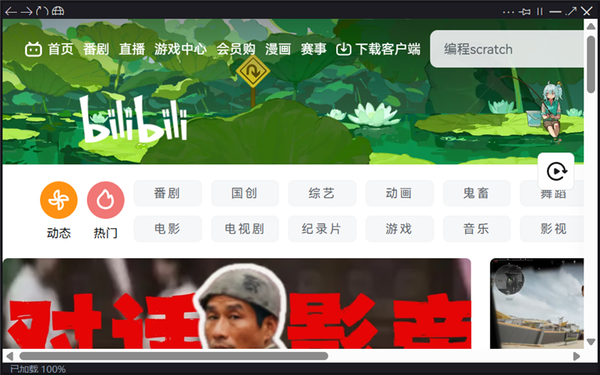

# MabaoClone

一个 **置顶小窗浏览器**：把网页（B站、抖音、米游社、任何网站）固定在最前面，边打游戏边看攻略视频；支持**全局热键**（暂停 / 快退 / 快进），在独占全屏的游戏里也能用。

- **50 KB** 主程序 + 系统自带 WebView2 运行时（不是 Electron，不打包浏览器内核）
- 无壳、无联网上报、无广告、无使用时长限制
- 打开即用，删除文件夹即卸载



## 特性

| 功能 | 说明 |
|---|---|
| 置顶小窗 | 无边框窗口，可拖动 / 拖边缩放 / 双击最大化，记住位置尺寸 |
| 全局热键 | `~` 暂停继续、`5` 快退 5 秒、`6` 快进 5 秒，**游戏全屏时同样有效** |
| 热键可改 | 界面里直接按键捕获，也可以改 `mabao.ini` |
| 页面缩放 | `Ctrl + 滚轮` / `Ctrl += - 0`，档位记忆 |
| 透明度 / 位置锁定 / 单击穿透 | 叠加在游戏上不挡操作 |
| 托盘常驻 | 关闭收进托盘，双击恢复 |
| 下载拦截 | 网站把页面当附件下发时自动拦下并改用页面方式打开 |

## 快速开始

### 方式一：下载成品

到 [Releases](../../releases) 下载最新的 `MabaoClone.zip`，解压后双击 `MabaoClone.exe`。

> **首次运行提示**：程序未做数字签名，Windows 可能提示「已保护你的电脑」——右键 zip → 属性 → 勾选「解除锁定」后再解压即可。
>
> 需要系统装有 [Microsoft Edge WebView2 运行时](https://developer.microsoft.com/microsoft-edge/webview2/)（Win10 1803+ 一般自带）。

### 方式二：自己编译

```powershell
git clone <this-repo>
cd <repo>
powershell -ExecutionPolicy Bypass -File .\build.ps1
```

编译产物在 `build\` 目录。脚本会自动从 NuGet 拉取 WebView2 SDK，使用系统自带的 .NET Framework 4.8 编译器（`csc.exe`），**不需要安装 Visual Studio**。

## 使用

| 键 | 作用 |
|---|---|
| `~` | 暂停 / 继续当前视频 |
| `5` | 快退 5 秒 |
| `6` | 快进 5 秒 |
| `Ctrl + 滚轮` | 缩放网页 |
| `F5` / `Ctrl+L` / `F11` | 刷新 / 地址栏 / 全屏 |
| `Ctrl+Shift+Q` | 退出 |

热键改法：工具栏 `⋯` → 设置快捷键… → 选一项 → 按下你想用的键。
步长（每次快进几秒）在 `mabao.ini` 的 `seekseconds=` 里改。

## 为什么需要管理员权限

很多游戏（如原神）由启动器以**管理员权限**运行。Windows 的 UIPI 规则规定：当前台窗口的完整性级别高于你的进程时，你的进程**收不到**全局热键和低级键盘钩子。

所以本程序在启动时会请求提权（可在 `⋯` 菜单里关闭）。同一原因也决定了实现里要用「注册式热键 + WH_KEYBOARD_LL 钩子」双通道，详见 [docs/技术说明.md](docs/技术说明.md)。

不想每次弹 UAC：双击 `enable_autostart_admin.bat` 创建一个登录时自动以最高权限运行的**计划任务**，之后不再弹框；`disable_autostart_admin.bat` 取消。

## 目录结构

```
src/Program.cs        主程序（WinForms + WebView2，单文件）
src/app.manifest      清单（asInvoker + PerMonitorV2 DPI）
src/icon.ico          图标
tools/make_icon.py     图标生成脚本（Pillow）
build.ps1             一键编译
docs/使用说明.md       面向最终用户的说明
docs/技术说明.md       实现细节（热键、钩子、JS 注入、下载拦截）
```

## 技术栈

- **UI**：.NET Framework 4.8 WinForms（免安装运行时，Windows 自带）
- **浏览器内核**：Microsoft Edge WebView2（使用系统已安装的运行时，不打包）
- **热键**：`RegisterHotKey` + `SetWindowsHookEx(WH_KEYBOARD_LL)` 双通道，带 250 ms 防抖
- **页面操作**：`ExecuteScriptAsync` 注入 JS（暂停/跳转/缩放），`WebMessageReceived` 回传状态

## 已知限制

- 只在 Windows 10/11 上测试过
- 只操作**第一个正在播放的 `<video>` 元素**；直播源无法跳转
- 单键热键（`~`/`5`/`6`）会被全局拦截，即任何程序里都打不出这些字符；介意的话改成 `F7`/`F8` 之类的功能键
- 程序未签名，首次运行可能需要手动解除锁定或加杀软白名单

## 免责声明

本程序只是一个**浏览器窗口**：不读取、不修改任何游戏的内存与网络数据，不注入游戏进程，不做自动化打怪。游戏内的热键之所以生效，是因为程序在监听键盘**并把按键转成网页里的播放控制**。

用于观看视频、阅读攻略等正常用途。使用本程序产生的任何后果由使用者自行承担。

## 许可证

[MIT](LICENSE)
